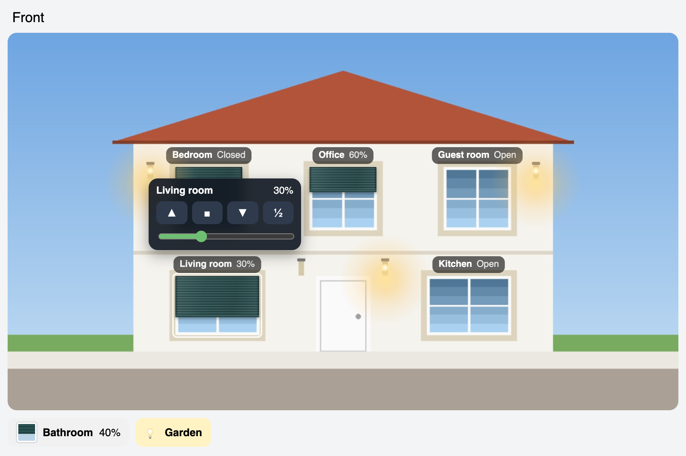

# House Shutters Card

[](https://github.com/hacs/integration)
[](https://github.com/dmdias/house-shutters-card/releases)
[](https://github.com/dmdias/house-shutters-card/actions/workflows/validate.yml)
[](LICENSE)
[](https://www.paypal.com/donate/?business=dmdias%40gmail.com&currency_code=EUR&item_name=House+Shutters+Card)

A Home Assistant dashboard card that draws your **roller shutters, lamps and
gates over a photo of your own house**. Each shutter comes down over its
window as far as it really is, lamps glow when they are on, and the gate
opens on the photo. Tap anything to control it.



*The picture above uses a drawn house; the card is meant for a photo of yours.*

## Contents

- [What you get](#what-you-get)
- [Installation](#installation)
- [Preparing the photo](#preparing-the-photo)
- [Configuration](#configuration)
- [Finding the coordinates](#finding-the-coordinates)
- [Gates](#gates)
- [Several photos side by side](#several-photos-side-by-side)
- [Troubleshooting](#troubleshooting)
- [Support the project](#support-the-project)
- [Author](#author)
- [License](#license)

## What you get

- **Shutters on the photo**: an aluminium roller shutter drawn over each
  window, down to the cover's current position, with a smooth movement.
  The colour and slat size are configurable.
- **Controls where the window is**: tap a window for open, stop, close, 50 %
  and a slider to choose the exact position.
- **Lamps**: tap a lamp on the photo to switch it, with a warm glow on the wall
  while it is on. Several lamps can share one light entity.
- **Gates**: swing gates that open on the photo, either by turning their
  leaves or with your own photos of the gate opening.
- **Things you cannot see**: shutters and lights that are not in the photo
  (a side wall, the garden) are shown as buttons under it.
- **Full width**: `house-shutters-grid` puts the front and the back of the
  house side by side in a panel view.
- English and Portuguese, following the Home Assistant language.

## Installation

1. HACS → **⋮ → Custom repositories** → add
   `https://github.com/dmdias/house-shutters-card` with type **Dashboard**.

   [](https://my.home-assistant.io/redirect/hacs_repository/?owner=dmdias&repository=house-shutters-card&category=plugin)
2. Search **House Shutters Card** → **Download**. HACS adds the dashboard
   resource.
3. Reload the browser. On the companion app, also clear its cache.

## Preparing the photo

1. Take a photo of the façade as straight as you can, in daylight, **with every
   shutter fully open**: the card draws the shutter coming down over the open
   window.
2. Make it about 1600 px wide (smaller files load faster).
3. Copy it to `/config/www/`, for example `/config/www/house/front.jpg`.
   It is then available as `/local/house/front.jpg`.

## Configuration

```yaml
type: custom:house-shutters-card
title: Front
image: /local/house/front.jpg
windows:
  - entity: cover.living_room
    name: Living room
    x: 25      # left edge of the window, % of the photo width
    y: 64.4        # top edge, % of the photo height
    w: 12.5      # width, % of the photo width
    h: 15.6      # height, % of the photo height
  - entity: cover.bedroom
    name: Bedroom
    x: 25
    y: 30
    w: 10
    h: 16.7
lights:
  - entity: light.porch
    name: Porch
    x: 56      # centre of the lamp
    y: 62
others:
  - entity: cover.bathroom
    name: Bathroom
other_lights:
  - entity: light.garden
    name: Garden
```

| Option | Description |
|---|---|
| `image` | **Required.** The photo of the house. |
| `title` | Optional title above the photo. |
| `color` | Shutter colour (default `#2a5152`, a dark aluminium green). |
| `slat_size` | Slat height in % of the photo width (default `0.28`). |
| `windows` | Shutters on the photo: `entity`, `name`, the box `x`, `y`, `w`, `h` (%), and `label: below` to put the name under the window. |
| `lights` | Lamps on the photo: `entity`, `name`, the centre `x`, `y` (%), and `size` to scale the lamp and its glow. Any entity that can be toggled works (light, switch). |
| `gates` | Swing gates, see [Gates](#gates). |
| `others` | Shutters not visible in the photo, shown as buttons under it. |
| `other_lights` | Lights not visible in the photo, shown as buttons under it. |

The shutters follow the `current_position` attribute of each cover (0 = closed,
100 = open). Covers without a position are drawn fully open or closed.

## Finding the coordinates

Open the photo in any image editor and note the pixel position of each window
(top-left corner, width and height) and of each lamp. Then divide by the size
of the photo:

- `x = left / photo width × 100`
- `y = top / photo height × 100`
- `w = width / photo width × 100`
- `h = height / photo height × 100`

For a 1600 × 900 photo, a window at (400, 580) that is 200 × 140 px gives
`x: 25`, `y: 64.4`, `w: 12.5`, `h: 15.6`. Fine-tune the numbers while looking
at the card; changes show as soon as you save the card.

## Gates

```yaml
gates:
  - entity: cover.gate
    name: Gate
    x: 12        # box of the whole gate (%)
    y: 55
    w: 28
    h: 33
    split: 50    # where the two leaves meet, % of the box width
    behind: [26, 61, 14, 10]   # part of the photo shown through the opening
```

Tap the gate for open, stop and close. The label shows *Open*, *Closed*,
*Opening* or *Closing*.

**With photos of the gate opening**, the effect is much more realistic. Take
three or four photos from the same place while the gate opens, cropped and
aligned to the same area of the main photo, and list them in order:

```yaml
    frames:
      - /local/house/gate-1.jpg    # slightly open
      - /local/house/gate-2.jpg
      - /local/house/gate-3.jpg    # fully open
    frames_box: [10, 42, 30, 52]   # where the frames go (x, y, w, h in %)
    duration: 15                            # seconds the gate takes to open
```

When the gate opens, the card steps through the frames over `duration`
seconds; it goes back through them when the gate closes.

## Several photos side by side

To use the whole width of the screen, put the photos in a **Panel** view inside
`house-shutters-grid`. They are side by side on wide screens and one under the
other on phones:

```yaml
type: custom:house-shutters-grid
min_width: 560      # optional, width of a photo before they wrap
cards:
  - title: Front
    image: /local/house/front.jpg
    windows: [...]
  - title: Back
    image: /local/house/back.jpg
    windows: [...]
```

## Troubleshooting

**The card says "Custom element doesn't exist: house-shutters-card"**
Reload the browser. On the companion app, clear its cache and close the app
completely. Check that the resource was added (Settings → Dashboards → ⋮ →
Resources).

**A shutter is not over its window**
Adjust `x`, `y`, `w` and `h`; a few tenths of a percent make a visible
difference.

**The slider moves but the shutter does not**
The card calls `cover.set_cover_position`; the cover must support setting a
position. Covers that only open and close can still be used with the buttons.

## Support the project

If you like it, you can buy me a coffee ☕. Thank you!

<a href="https://www.paypal.com/donate/?business=dmdias%40gmail.com&currency_code=EUR&item_name=House+Shutters+Card"></a>

Bug reports and ideas are welcome in the [issues](https://github.com/dmdias/house-shutters-card/issues).

## Author

**Daniel Dias** ([@dmdias](https://github.com/dmdias)).

## License

[GPL-3.0](LICENSE).
